# UTH E-Learning: mô tả trang web

UTH E-Learning là hệ thống học trực tuyến dành cho sinh viên. Người học có thể tìm khoá học,
ghi danh, xem bài giảng video, đánh dấu hoàn thành từng bài và theo dõi tiến độ. Giảng viên và
quản trị viên quản lý nội dung qua một trang quản trị riêng.

Ảnh minh hoạ nằm trong thư mục [`screenshots/`](screenshots/).

## 1. Công nghệ sử dụng

| Thành phần | Công nghệ |
| --- | --- |
| Backend | PHP 8.4, Laravel 13 (mô hình MVC, Eloquent ORM) |
| Cơ sở dữ liệu | MySQL |
| Giao diện | Blade, Tailwind CSS (responsive), Alpine.js, build bằng Vite |
| Soạn thảo nội dung | CKEditor 5 (rich text, chèn ảnh, bảng, video) |
| Biểu đồ | Chart.js |
| Xác thực | Laravel Breeze (đăng ký, đăng nhập, quên mật khẩu) |
| Ngôn ngữ giao diện | Tiếng Việt (`lang/vi`, `lang/vi.json`) |

## 2. Vai trò người dùng

| Vai trò | Được làm gì |
| --- | --- |
| Khách | Xem trang chủ, thư viện khoá học, chi tiết khoá học, thông báo; đăng ký tài khoản |
| Học viên (`student`) | Ghi danh hoặc huỷ ghi danh, học bài, đánh dấu hoàn thành, xem tiến độ ở Góc học tập, đánh giá khoá học, sửa hồ sơ và ảnh đại diện |
| Giảng viên (`teacher`) | Vào trang quản trị; quản lý khoá học **của mình** và bài học; xem ghi danh, đánh giá |
| Quản trị viên (`admin`) | Toàn quyền, thêm cả quản lý danh mục, người dùng (gán vai trò) và thông báo |

Phân quyền dùng middleware `role:admin,teacher` cho khu `/admin` và `CoursePolicy` để giảng
viên chỉ sửa được khoá học mình phụ trách.

## 3. Các trang dành cho người dùng

### 3.1 Trang chủ (`/`)

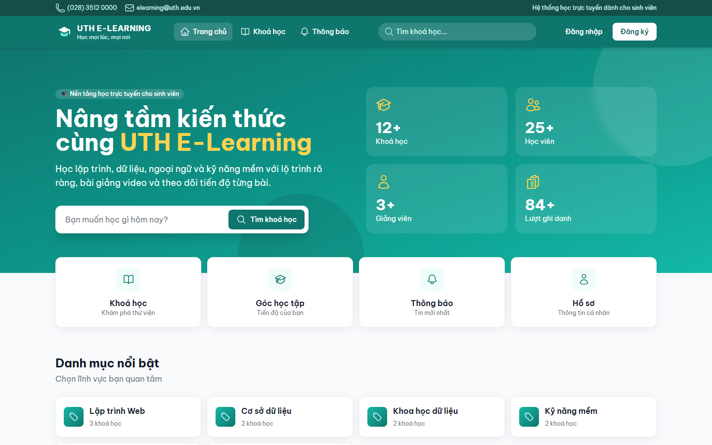

- Banner giới thiệu kèm ô tìm khoá học.
- Bốn thẻ số liệu: số khoá học, học viên, giảng viên, lượt ghi danh.
- Ô truy cập nhanh: Khoá học, Góc học tập, Thông báo, Hồ sơ.
- Danh mục nổi bật, khoá học nổi bật và thông báo mới nhất.

### 3.2 Thư viện khoá học (`/khoa-hoc`)

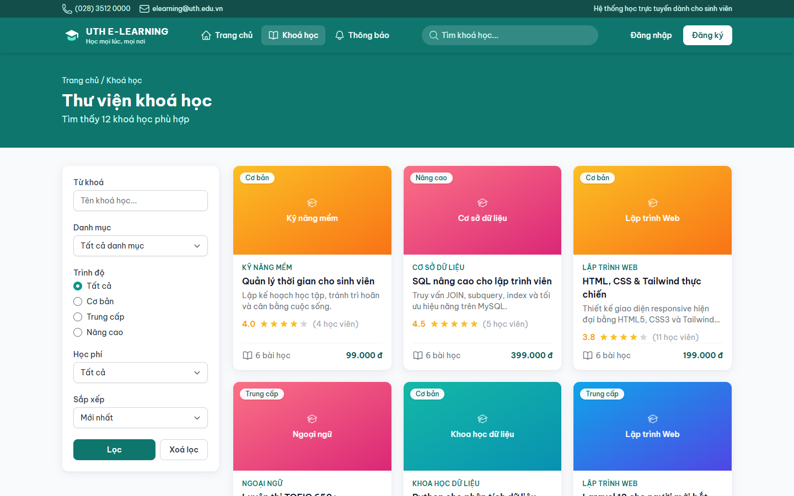

- Tìm theo tên khoá học.
- Lọc theo danh mục, trình độ (Cơ bản, Trung cấp, Nâng cao) và học phí (Miễn phí, Có phí).
- Sắp xếp: Mới nhất, Phổ biến nhất, Học phí tăng dần, Học phí giảm dần.
- Kết quả có phân trang.

### 3.3 Chi tiết khoá học (`/khoa-hoc/{slug}`)

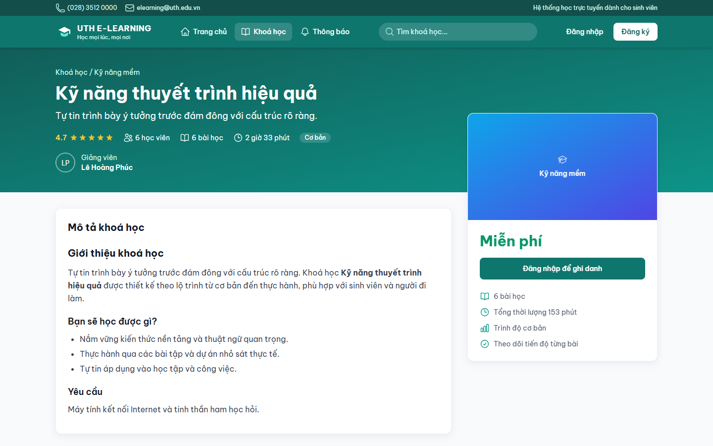

- Thư viện nhiều ảnh của khoá học.
- Mô tả dạng rich text, thông tin giảng viên, học phí, trình độ.
- Danh sách bài học; bài học thử (preview) xem được khi chưa ghi danh.
- Nút ghi danh hoặc huỷ ghi danh.
- Đánh giá sao và bình luận của học viên, có phân trang. Mỗi học viên đánh giá một khoá một lần.

### 3.4 Đăng nhập và đăng ký (`/login`, `/register`)

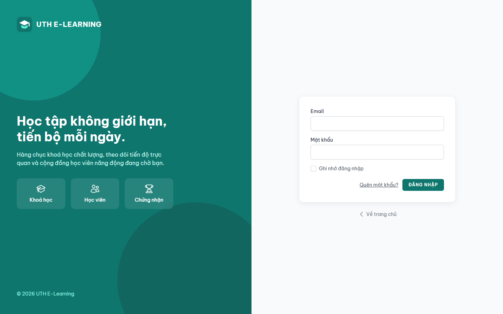

Đăng nhập, đăng ký, quên mật khẩu và đặt lại mật khẩu (Laravel Breeze, đã Việt hoá).

### 3.5 Góc học tập (`/dashboard`)

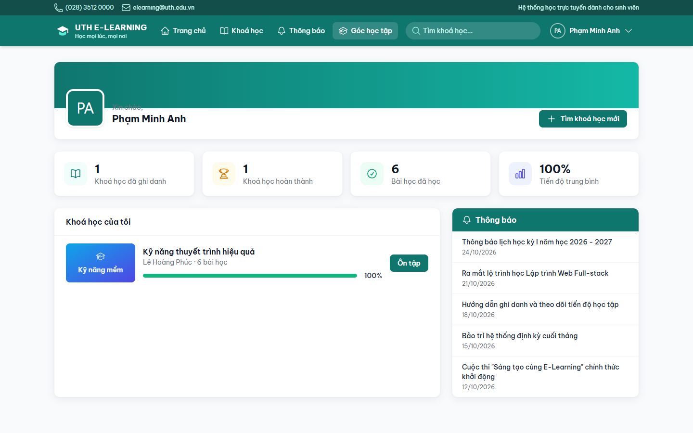

Trang riêng của học viên sau khi đăng nhập:

- Thống kê: khoá đã ghi danh, khoá đã hoàn thành, số bài đã học, tiến độ trung bình.
- Danh sách "Khoá học của tôi" kèm thanh % hoàn thành và nút Học tiếp / Ôn tập.
- Cột thông báo mới.

### 3.6 Học bài (`/hoc/{khoá học}/{bài học}`)

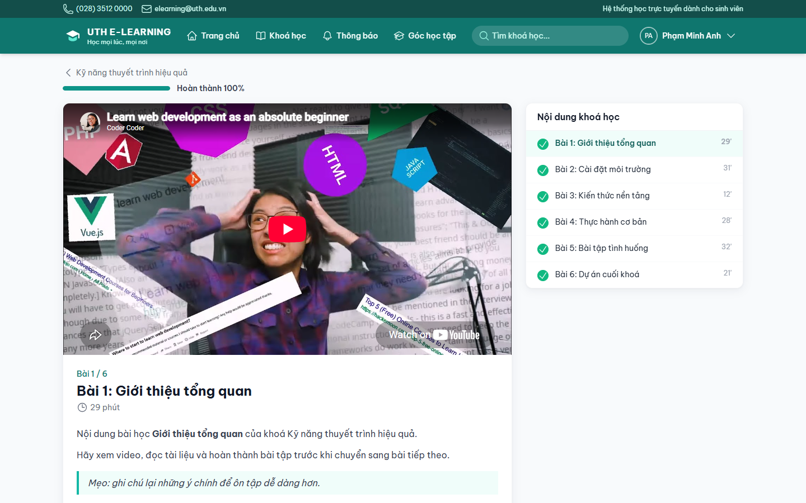

- Video YouTube của bài học và nội dung bài (rich text).
- Thanh tiến độ phần trăm hoàn thành của cả khoá.
- Cột "Nội dung khoá học" liệt kê các bài, đánh dấu bài đã hoàn thành.
- Nút đánh dấu hoàn thành bài và chuyển sang bài tiếp theo.

### 3.7 Thông báo (`/thong-bao`)

Danh sách và trang chi tiết các thông báo do quản trị viên đăng.

### 3.8 Hồ sơ (`/profile`)

Sửa họ tên, email, số điện thoại, giới thiệu, ảnh đại diện; đổi mật khẩu; xoá tài khoản.

## 4. Trang quản trị (`/admin`)

Chỉ `admin` và `teacher` vào được. Thanh bên trái chia nhóm Tổng quan, Đào tạo, Hệ thống.

### 4.1 Bảng điều khiển

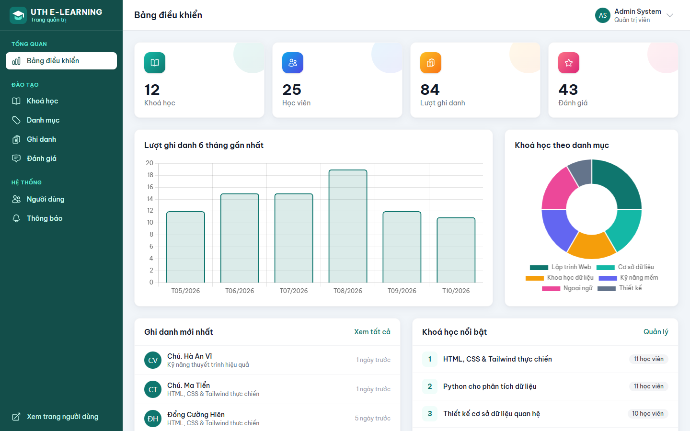

- Thẻ thống kê: khoá học, học viên, lượt ghi danh, đánh giá.
- Biểu đồ cột lượt ghi danh 6 tháng gần nhất và biểu đồ tròn khoá học theo danh mục (Chart.js).
- Ghi danh mới nhất và khoá học nổi bật.

### 4.2 Quản lý khoá học

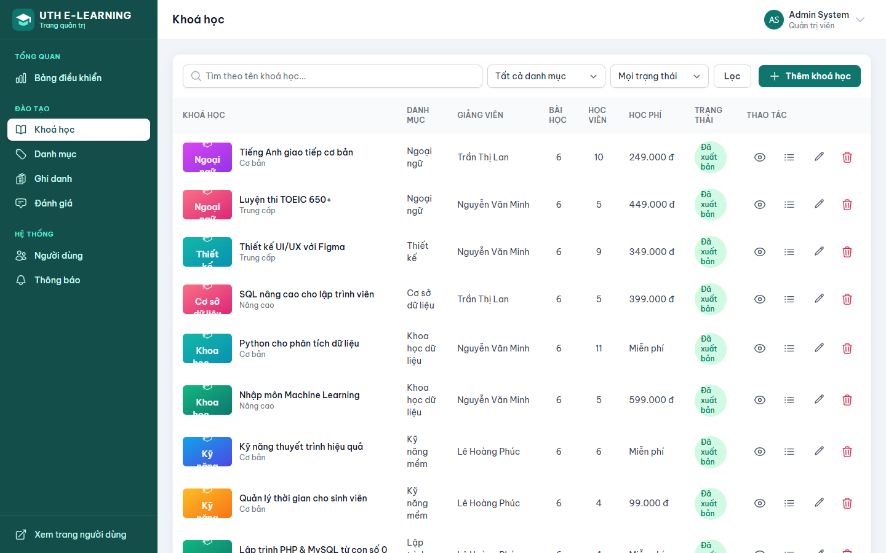

- Danh sách khoá học có tìm kiếm, bộ lọc và phân trang.
- Thêm, sửa, xoá khoá học; ảnh đại diện và upload nhiều ảnh (tối đa 10 ảnh mỗi lần, 2MB mỗi ảnh).
- Quản lý bài học của từng khoá: tiêu đề, nội dung, link video, thời lượng, thứ tự, bài học thử.

### 4.3 Soạn nội dung bằng CKEditor

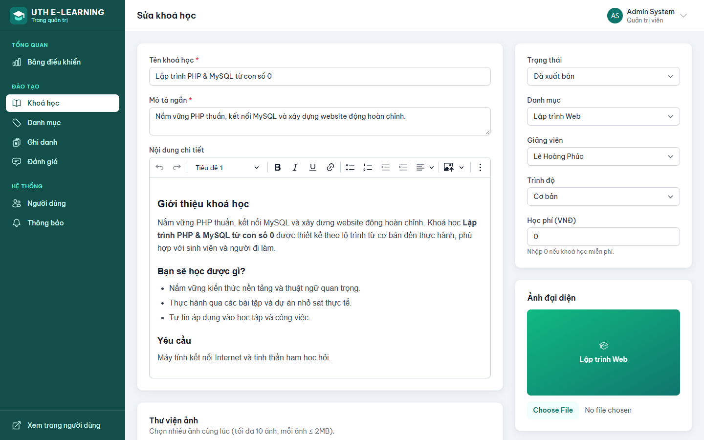

Mô tả khoá học, nội dung bài học và thông báo được soạn bằng CKEditor 5, chèn được ảnh
(upload qua `/admin/editor-upload`), bảng và video. Nội dung được lọc bằng `HtmlSanitizer`
trước khi hiển thị để chống XSS.

### 4.4 Quản lý người dùng (chỉ admin)

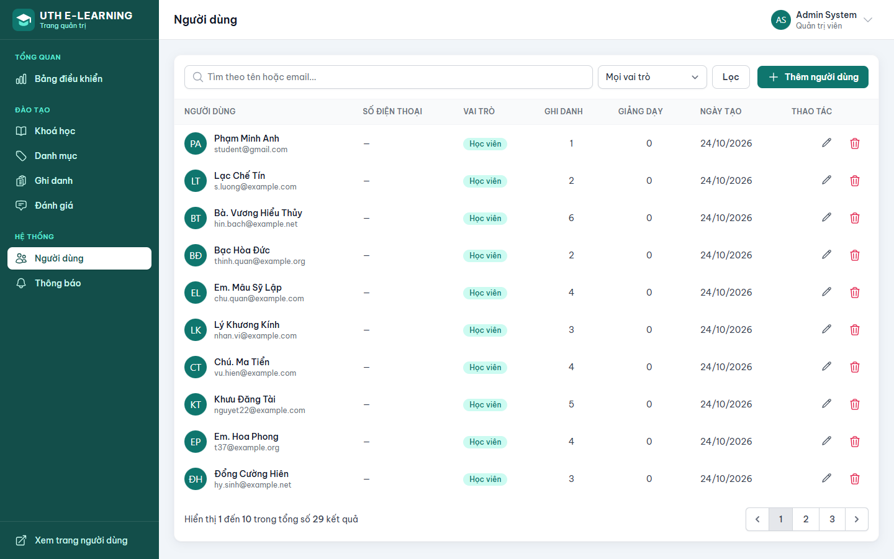

Thêm, sửa, xoá người dùng và gán vai trò admin, teacher, student. Có tìm kiếm và lọc theo vai trò.

### 4.5 Các mục khác

- **Danh mục** (chỉ admin): thêm, sửa, xoá danh mục khoá học.
- **Ghi danh**: xem và xoá lượt ghi danh.
- **Đánh giá**: duyệt, ẩn hoặc xoá đánh giá.
- **Thông báo** (chỉ admin): đăng, sửa, xoá thông báo, có ảnh và trạng thái xuất bản.

## 5. Giao diện điện thoại

| Trang chủ | Chi tiết khoá học |
| --- | --- |
| 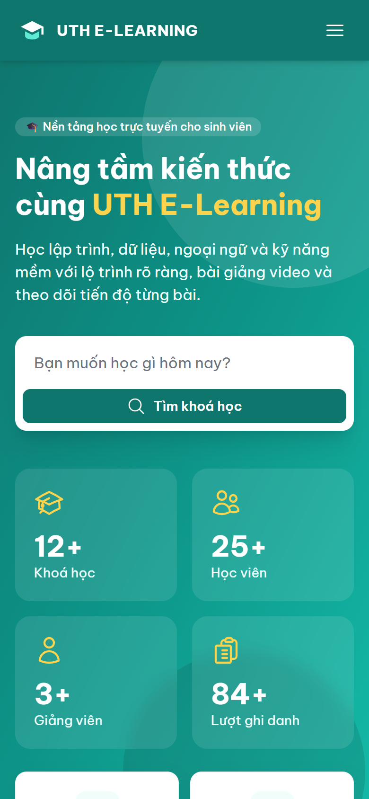 | 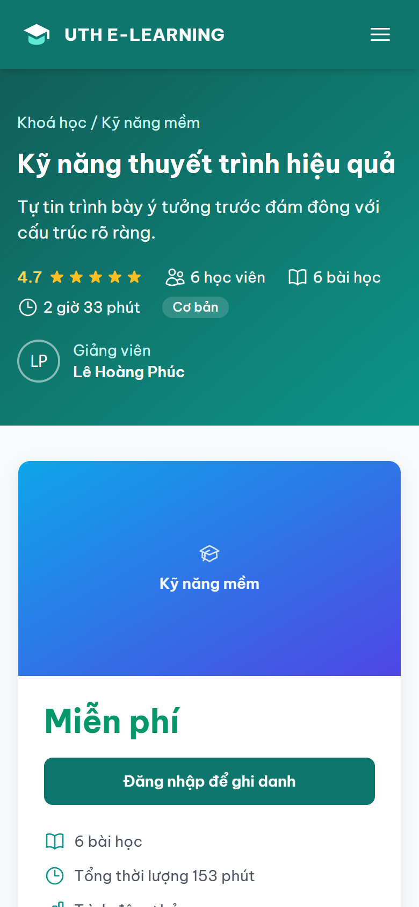 |

Toàn bộ trang dùng Tailwind responsive: menu thu gọn thành nút hamburger, lưới khoá học chuyển
thành một cột.

## 6. Cơ sở dữ liệu

Các bảng chính: `users`, `categories`, `courses`, `course_images`, `lessons`, `enrollments`,
`lesson_completions`, `reviews`, `announcements`. Sơ đồ ERD và use case chi tiết nằm trong
[phan-tich-thiet-ke.md](phan-tich-thiet-ke.md).

## 7. Cấu trúc thư mục chính

| Thư mục | Nội dung |
| --- | --- |
| `app/Http/Controllers` | Controller trang người dùng; `Admin/` cho trang quản trị |
| `app/Models` | Model Eloquent |
| `app/Enums` | `UserRole`, `CourseLevel`, `CourseStatus` |
| `app/Policies/CoursePolicy.php` | Quyền sửa khoá học |
| `app/Support` | `HtmlSanitizer`, `UniqueSlug` |
| `resources/views` | Giao diện Blade (`admin/`, `courses/`, `learn/`, `layouts/`, `components/`) |
| `database/migrations`, `database/seeders` | Cấu trúc bảng và dữ liệu mẫu |
| `routes/web.php` | Khai báo đường dẫn |
| `tests/Feature` | Kiểm thử tính năng |
| `docs/` | Tài liệu |
